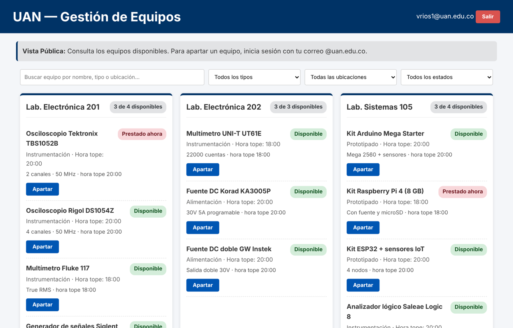
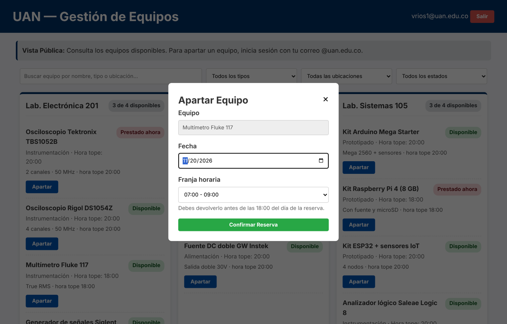
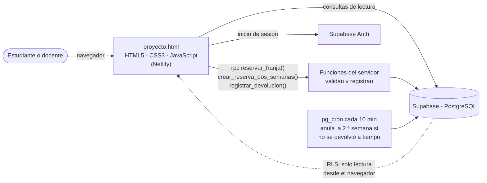

<div align="center">

# Gestión de Equipos de Laboratorio

**Consulta, reserva y control de devolución de los equipos de laboratorio de la Universidad Antonio Nariño**

> **Regla propia del proyecto:** todo equipo prestado debe ser devuelto antes de una hora tope establecida.

[](https://gestion-equipos-laboratorio-uan.netlify.app/)
[](https://app.netlify.com/projects/gestion-equipos-laboratorio-uan/deploys)


Equipo **Error 404** · Gestión de Proyectos de Software · UAN Sede Sur, Bogotá D.C. · 2026-II

</div>

---

## Contenido

- [Qué hace](#qué-hace)
- [Estado del proyecto](#estado-del-proyecto)
- [Arquitectura y stack](#arquitectura-y-stack)
- [Reglas de negocio validadas en el servidor](#reglas-de-negocio-validadas-en-el-servidor)
- [Puesta en marcha](#puesta-en-marcha)
- [Estructura del repositorio](#estructura-del-repositorio)
- [Forma de trabajo](#forma-de-trabajo)
- [Equipo](#equipo)

## Qué hace

| Catálogo con estado y filtros | Reserva con hora tope |
| :---: | :---: |
|  |  |

- **Catálogo:** los 15 equipos agrupados por laboratorio, con su hora tope y su estado: *Disponible*, *Prestado ahora* o *En mantenimiento*.
- **Búsqueda y filtros:** por nombre, tipo, ubicación y estado.
- **Disponibilidad:** solo se ofrecen las franjas libres, futuras y que empiezan antes de la hora tope del equipo.
- **Préstamo:** queda asociado a quien inicia sesión (desde el 24 nov, eligiendo su usuario en una lista desplegable, CC-16), con fecha, franja y **hora tope guardada**.
- **Reserva de dos semanas (CR-01):** casilla «Reservar también la semana siguiente». Si la segunda semana está ocupada o es festivo, solo se reserva la primera; si el equipo no se devuelve a tiempo la primera semana, la segunda se anula sola.
- **Mis préstamos y devolución:** cada usuario ve sus préstamos con su estado (*Pendiente*, *Vencido*, *Devuelto a tiempo*, *Devuelto fuera de tiempo*, *Anulada*) y registra la devolución.

> Capturas tomadas con los datos semilla del profesor.

## Estado del proyecto

Backlog en Jira (proyecto **SCRUM**): 7 historias de usuario en 5 épicas, 47 story points.

| Historia | Descripción | SP | Sprint | Estado |
| --- | --- | :---: | :---: | --- |
| HU-01 | Catálogo de equipos | 5 | 1 | ✅ Terminada |
| HU-02 | Búsqueda y filtros | 5 | 1 | ✅ Terminada |
| HU-03 | Consulta de disponibilidad | 3 | 2 | ✅ Terminada |
| HU-04 | Registro de préstamo | 13 | 2 | ✅ Terminada |
| HU-05 | Registro de devolución | 8 | 3 | ✅ Finalizado · 23 nov |
| HU-06 | Validación de la hora tope y reserva de dos semanas | 8 | 3 | ✅ Finalizado · 23 nov |
| HU-07 | Consulta y cancelación de préstamos | 5 | — | ⏸ Backlog de producto (salió del Sprint 3 por el CR-01, CC-10) |

Estado al 25 nov de 2026: Sprint 3 cerrado con 16 de 16 SP, más dos ajustes del PO del 24 nov sin cambio de SP: ingreso por lista desplegable (CC-16) y equipo sin devolver no se puede reservar (CC-17). El detalle está en las secciones 2.10 y 12.6 a 12.8 del [documento de gestión V4.5](docs/ERROR404_Documento_de_gestion_Corte4_V4.5.pdf).

**Deuda técnica del Sprint 2, pagada el 11 nov:** validación de reservas en el servidor y hora tope guardada (DT-01), estado del equipo y filtro por estado (DT-02), y trazabilidad entre GitHub y Jira (DT-03).

## Arquitectura y stack



| Capa | Tecnología | Para qué |
| --- | --- | --- |
| Interfaz | HTML5, CSS3 y JavaScript en un solo archivo | Catálogo, filtros, disponibilidad y reserva |
| Datos | Supabase (PostgreSQL) | Equipos, usuarios, franjas y reservas |
| Lógica de servidor | Funciones `reservar_franja()`, `crear_reserva_dos_semanas()` y `registrar_devolucion()`, índice único, políticas RLS y tarea `pg_cron` | Reglas de negocio que no dependen del navegador |
| Identificación | Supabase Auth | Saber quién solicita el préstamo |
| Publicación | Netlify | URL pública para revisión y demostración |
| Gestión | Jira (SCRUM) · Git y GitHub | Backlog, sprints, revisión cruzada |

> El Charter inicial planteaba PHP + MySQL. El cambio a Supabase/PostgreSQL está registrado como **CC-04** en el documento de gestión.

## Reglas de negocio validadas en el servidor

| Regla | Cómo se aplica | DoD v2 |
| --- | --- | :---: |
| Una franja con reserva activa no se puede volver a reservar, ni siquiera con dos solicitudes simultáneas | `reservar_franja()` + índice `ux_reservas_franja_activa` | 20 |
| No se reserva una franja que ya pasó (hora de Bogotá) | `reservar_franja()` | 19 |
| La hora tope del equipo queda guardada en cada préstamo | `recursos.hora_tope` → `reservas.hora_tope` | CA04 |
| No se reserva una franja que empieza en la hora tope del equipo o después | `reservar_franja()` | Regla propia |
| El navegador no puede escribir directamente en las tablas | RLS sin políticas de escritura | 18 |
| Reserva de dos semanas: la segunda solo si su franja existe y está libre | `crear_reserva_dos_semanas()` | CR-01 |
| La devolución se compara con la hora tope y queda *a tiempo* o *fuera de tiempo* | `registrar_devolucion()` | HU-05, HU-06 |
| Si la primera semana no se devuelve a tiempo, la segunda se anula y la franja queda libre | Disparador + `pg_cron` cada 10 min | CR-01 |
| Un equipo con un préstamo vencido sin devolver, hecho en la página (no cuentan las 570 reservas semilla del profesor), no admite reservas nuevas hasta que se devuelva | `reservar_franja()` | CC-17 |

Todas las reglas tienen prueba automática en [`proyecto304/base_de_datos/pruebas/`](proyecto304/base_de_datos/pruebas/): 6/6, 9/9 y 9/9 con usuario real (24 nov, con el caso nuevo de CC-17).

## Puesta en marcha

### 1. Base de datos (Supabase → SQL Editor)

Proyecto de Supabase en uso: **`gestion-equipos-laboratorio-uan`** (desde el 15 nov de 2026, CC-11). Los scripts están en [`proyecto304/base_de_datos/`](proyecto304/base_de_datos/); su [README](proyecto304/base_de_datos/README.md) tiene el detalle.

| Paso | Archivo | Nota |
| :---: | --- | --- |
| 0 | `00_diagnostico.sql` | Solo lectura. Dice en qué estado está la base y qué scripts faltan. |
| 1–3 | `01_esquema_profesor.sql`, `02_datos_profesor.sql`, `03_datos_complemento_profesor.sql` | Datos oficiales del profesor: 15 equipos, 40 usuarios, 7.110 franjas hasta el 31 dic y 570 reservas. **El 01 borra las tablas si ya existen.** |
| 4 | `04_validaciones_servidor_hora_tope.sql` | Hora tope, `reservar_franja()`, índices y RLS. |
| 5 | `05_devoluciones_y_reserva_dos_semanas.sql` | Devolución, reserva de dos semanas y anulación automática. Requiere la extensión `pg_cron`. |
| 6 | `06_verificacion.sql` | Solo lectura. Todos los valores deben coincidir con lo esperado. |
| 7 | `07_ajustes_seguridad_rendimiento.sql` | Ajustes de los avisos de seguridad de Supabase. |
| 8 | `08_acceso_por_lista.sql` | Ingreso por lista desplegable de usuarios (demo educativa). |
| 9 | `09_equipo_sin_devolver.sql` | Un equipo sin devolver no se puede volver a reservar (CC-17). |
| — | `pruebas/*.sql` | 6/6, 9/9 y 9/9. Se deshacen solas: no dejan datos. |

> `supabase_setup_profesor.sql` y `migraciones/001_...sql` quedan solo como historial: el primero no trae el complemento del profesor y la segunda generaba franjas propias que chocan con las oficiales. **No ejecutarlos.**

### 2. Autenticación

En **Authentication → Providers**, habilitar *Email* y dejar activa la confirmación de correo. En **URL Configuration**, *Site URL* `https://gestion-equipos-laboratorio-uan.netlify.app` y redirección `https://gestion-equipos-laboratorio-uan.netlify.app/**`.

Solo pueden reservar las cuentas cuyo correo exista en la tabla `usuarios`.

**Desde el 24 nov (CC-16, demo educativa):** la página no pide correo ni contraseña. «Iniciar Sesión» muestra la lista de los 41 usuarios y, al elegir uno, entra con una clave de demostración común que crea el script `08_acceso_por_lista.sql`. Cualquiera puede entrar como cualquier usuario: no usar así con datos reales.

### 3. Publicación

1. En [`proyecto304/proyecto.html`](proyecto304/proyecto.html), `SUPABASE_URL` y `SUPABASE_KEY` deben ser los del proyecto. La clave *publishable* es pública por diseño; la seguridad la dan las políticas RLS.
2. **Despliegue continuo:** el sitio de Netlify `gestion-equipos-laboratorio-uan` está conectado a este repositorio. Cada push a `main` publica automáticamente (en pausa desde el 24 nov porque el equipo agotó los créditos del ciclo de Netlify; la versión con CC-16 se ve en la vista previa https://deploy-preview-9--gestion-equipos-laboratorio-uan.netlify.app), según [`netlify.toml`](netlify.toml): publica `proyecto304/` sin compilación, muestra `proyecto.html` en la raíz y no expone los scripts SQL.

> **Plan gratuito:** Supabase pausa el proyecto tras una semana sin uso. Abrir la URL 24 h y 1 h antes de cada Sprint Review (riesgo R-03).

## Estructura del repositorio

```
gestion-equipos-laboratorio/
├── proyecto304/
│   ├── proyecto.html                          Aplicación web
│   ├── base_de_datos/                         Base vigente: scripts 00 a 07, pruebas y reparación
│   ├── supabase_setup_profesor.sql            Historial (no usar)
│   ├── migraciones/001_...sql                 Historial (no usar)
│   └── pruebas/pruebas_reglas_servidor.sql    Historial; la vigente está en base_de_datos/pruebas
└── docs/
    ├── ERROR404_Documento_de_gestion_Corte4_V4.5.docx/.pdf   Documento de gestión vigente (25 nov)
    ├── img/                                                   Capturas
    └── historico/                                             Charter, DoD y versiones anteriores
```

## Forma de trabajo

- **Scrum con tres sprints:** cierres el 25 sep, el 30 oct y el 27 nov de 2026. El tablero de Jira es la fuente del avance.
- **Ramas:** una por tarea, con el nombre `tipo/SCRUM-NN-descripcion`.
- **Commits y Pull Requests:** llevan la clave de Jira (`SCRUM-13: ...`) para que la incidencia muestre su código.
- **Revisión cruzada:** otro Developer revisa y aprueba el Pull Request antes de fusionar a `main` (DoD v2, criterio 16).
- **Terminado** significa que cumple los criterios de aceptación y la Definition of Done, y que está desplegado en la URL pública.

## Equipo

| Integrante | Rol |
| --- | --- |
| Andrés Felipe | Scrum Master |
| Cristian Herrera | Product Owner |
| David Vásquez | Developer |
| Juan Pérez | Developer |

Profesor: Ing. Jhonatan Sneider Rico Pinto, MSc. · Universidad Antonio Nariño, Sede Sur.
