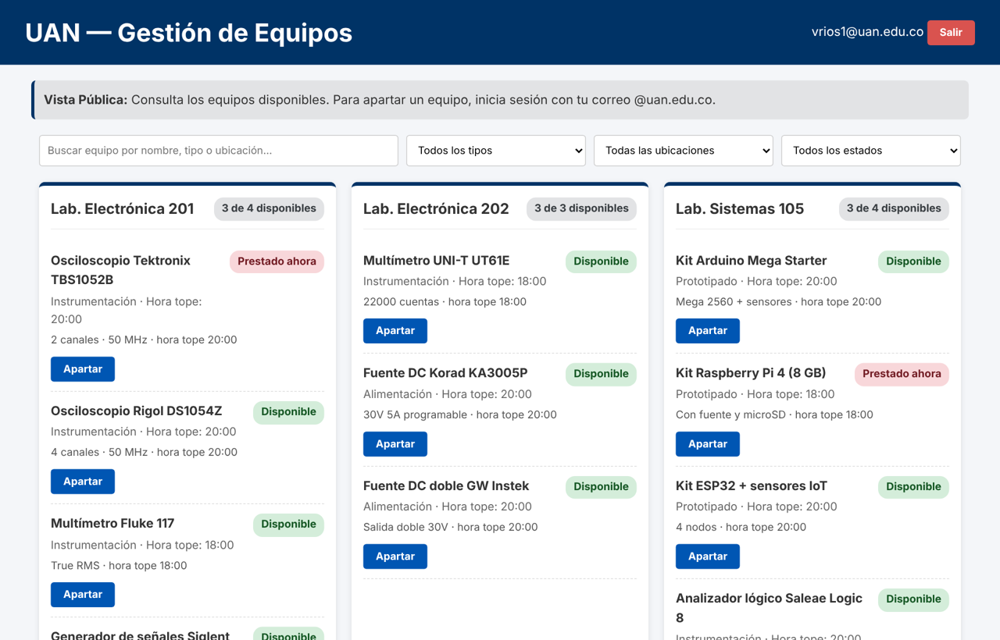
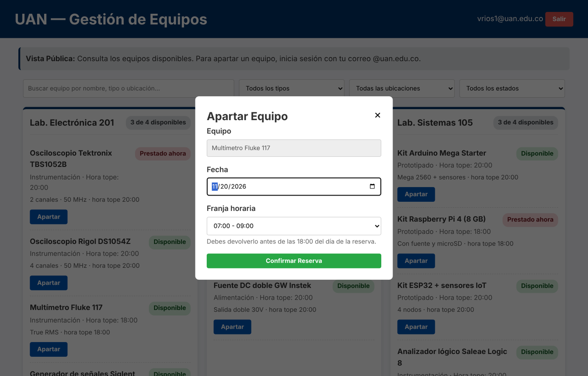
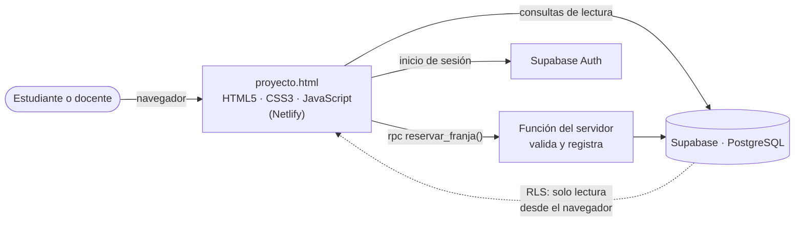

<div align="center">

# Gestión de Equipos de Laboratorio

**Consulta, reserva y control de devolución de los equipos de laboratorio de la Universidad Antonio Nariño**

> **Regla propia del proyecto:** todo equipo prestado debe ser devuelto antes de una hora tope establecida.

[](https://superlative-klepon-d1cb47.netlify.app/)
[](https://app.netlify.com/projects/superlative-klepon-d1cb47/deploys)


Equipo **Error 404** · Gestión de Proyectos de Software · UAN Sede Sur, Bogotá D.C. · 2026-II

</div>

---

## Contenido

- [Qué hace](#qué-hace)
- [Estado del proyecto](#estado-del-proyecto)
- [Arquitectura y stack](#arquitectura-y-stack)
- [Reglas de negocio validadas en el servidor](#reglas-de-negocio-validadas-en-el-servidor)
- [Puesta en marcha](#puesta-en-marcha)
- [Estructura del repositorio](#estructura-del-repositorio)
- [Forma de trabajo](#forma-de-trabajo)
- [Equipo](#equipo)

## Qué hace

| Catálogo con estado y filtros | Reserva con hora tope |
| :---: | :---: |
|  |  |

- **Catálogo:** los 15 equipos agrupados por laboratorio, con su hora tope y su estado: *Disponible*, *Prestado ahora* o *En mantenimiento*.
- **Búsqueda y filtros:** por nombre, tipo, ubicación y estado.
- **Disponibilidad:** solo se ofrecen las franjas libres, futuras y que empiezan antes de la hora tope del equipo.
- **Préstamo:** queda asociado a quien inicia sesión con su correo `@uan.edu.co`, con fecha, franja y **hora tope guardada**.
- **En construcción (Sprint 3):** registro de devoluciones, clasificación *Devuelto a tiempo* / *Fuera de tiempo*, reserva de dos semanas, y consulta y cancelación de préstamos.

> Capturas tomadas con los datos semilla del profesor.

## Estado del proyecto

Backlog en Jira (proyecto **SCRUM**): 7 historias de usuario en 5 épicas, 47 story points.

| Historia | Descripción | SP | Sprint | Estado |
| --- | --- | :---: | :---: | --- |
| HU-01 | Catálogo de equipos | 5 | 1 | ✅ Terminada |
| HU-02 | Búsqueda y filtros | 5 | 1 | ✅ Terminada |
| HU-03 | Consulta de disponibilidad | 3 | 2 | ✅ Terminada |
| HU-04 | Registro de préstamo | 13 | 2 | ✅ Terminada |
| HU-05 | Registro de devolución | 8 | 3 | 🔄 En curso · meta 21 nov |
| HU-06 | Validación de la hora tope y reserva de dos semanas | 8 | 3 | 🔄 En curso · meta 25 nov |
| HU-07 | Consulta y cancelación de préstamos | 5 | 3 | 🔄 En curso · meta 27 nov |

**Deuda técnica del Sprint 2, pagada el 11 nov:** validación de reservas en el servidor y hora tope guardada (DT-01), estado del equipo y filtro por estado (DT-02), y trazabilidad entre GitHub y Jira (DT-03).

## Arquitectura y stack



| Capa | Tecnología | Para qué |
| --- | --- | --- |
| Interfaz | HTML5, CSS3 y JavaScript en un solo archivo | Catálogo, filtros, disponibilidad y reserva |
| Datos | Supabase (PostgreSQL) | Equipos, usuarios, franjas y reservas |
| Lógica de servidor | Función `reservar_franja()`, índice único y políticas RLS | Reglas de negocio que no dependen del navegador |
| Identificación | Supabase Auth | Saber quién solicita el préstamo |
| Publicación | Netlify | URL pública para revisión y demostración |
| Gestión | Jira (SCRUM) · Git y GitHub | Backlog, sprints, revisión cruzada |

> El Charter inicial planteaba PHP + MySQL. El cambio a Supabase/PostgreSQL está registrado como **CC-04** en el documento de gestión.

## Reglas de negocio validadas en el servidor

| Regla | Cómo se aplica | DoD v2 |
| --- | --- | :---: |
| Una franja con reserva activa no se puede volver a reservar, ni siquiera con dos solicitudes simultáneas | `reservar_franja()` + índice `ux_reservas_franja_activa` | 20 |
| No se reserva una franja que ya pasó (hora de Bogotá) | `reservar_franja()` | 19 |
| La hora tope del equipo queda guardada en cada préstamo | `recursos.hora_tope` → `reservas.hora_tope` | CA04 |
| No se reserva una franja que empieza en la hora tope del equipo o después | `reservar_franja()` | Regla propia |
| El navegador no puede escribir directamente en las tablas | RLS sin políticas de escritura | 18 |

Las cinco reglas tienen prueba automática en [`proyecto304/pruebas/pruebas_reglas_servidor.sql`](proyecto304/pruebas/pruebas_reglas_servidor.sql).

## Puesta en marcha

### 1. Base de datos (Supabase → SQL Editor)

| Paso | Archivo | Nota |
| :---: | --- | --- |
| 1 | [`supabase_setup_profesor.sql`](proyecto304/supabase_setup_profesor.sql) | Tablas y datos semilla: 15 equipos, 40 usuarios, 1.800 franjas, 216 reservas. **Borra las tablas si ya existen.** |
| 2 | [`migraciones/001_validaciones_servidor_hora_tope.sql`](proyecto304/migraciones/001_validaciones_servidor_hora_tope.sql) | Reglas de servidor, hora tope y franjas del 5 oct al 11 dic de 2026. No borra datos; se puede ejecutar más de una vez. |
| 3 | [`pruebas/pruebas_reglas_servidor.sql`](proyecto304/pruebas/pruebas_reglas_servidor.sql) | Debe mostrar 5 filas `OK`. No deja datos de prueba. |

> Mientras no se ejecute el paso 2, la página sigue funcionando en un modo de compatibilidad (validación en el navegador). Con la migración aplicada, solo queda la validación del servidor.

### 2. Autenticación

En **Authentication → Providers**, habilitar *Email*. Solo pueden reservar las cuentas cuyo correo exista en la tabla `usuarios`.

### 3. Publicación

1. En [`proyecto304/proyecto.html`](proyecto304/proyecto.html), `SUPABASE_URL` y `SUPABASE_KEY` deben ser los del proyecto. La clave *publishable* es pública por diseño; la seguridad la dan las políticas RLS.
2. **Despliegue continuo:** el sitio de Netlify `superlative-klepon-d1cb47` está conectado a este repositorio. Cada push a `main` publica automáticamente, según [`netlify.toml`](netlify.toml): publica `proyecto304/` sin compilación, muestra `proyecto.html` en la raíz y no expone los scripts SQL.

> **Plan gratuito:** Supabase pausa el proyecto tras una semana sin uso. Abrir la URL 24 h y 1 h antes de cada Sprint Review (riesgo R-03).

## Estructura del repositorio

```
gestion-equipos-laboratorio/
├── proyecto304/
│   ├── proyecto.html                          Aplicación web
│   ├── supabase_setup_profesor.sql            Esquema y datos del profesor
│   ├── migraciones/
│   │   └── 001_validaciones_servidor_hora_tope.sql
│   └── pruebas/
│       └── pruebas_reglas_servidor.sql
└── docs/
    ├── ERROR404_Documento_de_gestion_Corte3_V4.1.docx   Charter, DoD, riesgos, sprints y deuda técnica
    ├── img/                                           Capturas
    └── historico/                                     Charter y DoD del Corte 1
```

## Forma de trabajo

- **Scrum con tres sprints:** cierres el 25 sep, el 30 oct y el 27 nov de 2026. El tablero de Jira es la fuente del avance.
- **Ramas:** una por tarea, con el nombre `tipo/SCRUM-NN-descripcion`.
- **Commits y Pull Requests:** llevan la clave de Jira (`SCRUM-13: ...`) para que la incidencia muestre su código.
- **Revisión cruzada:** otro Developer revisa y aprueba el Pull Request antes de fusionar a `main` (DoD v2, criterio 16).
- **Terminado** significa que cumple los criterios de aceptación y la Definition of Done, y que está desplegado en la URL pública.

## Equipo

| Integrante | Rol |
| --- | --- |
| Andrés Felipe | Scrum Master |
| Cristian Herrera | Product Owner |
| David Vásquez | Developer |
| Juan Pérez | Developer |

Profesor: Ing. Jhonatan Sneider Rico Pinto, MSc. · Universidad Antonio Nariño, Sede Sur.
